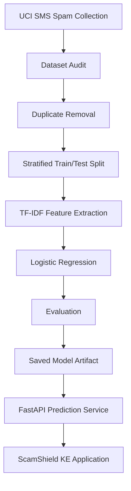
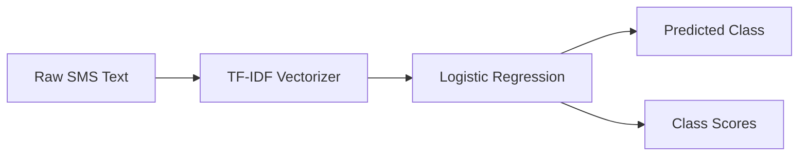

# ScamShield KE — Machine Learning Pipeline

**A reproducible, CPU-friendly machine-learning pipeline for SMS spam classification and suspicious-message screening.**

[](https://www.python.org/)
[](https://scikit-learn.org/)
[](https://archive.ics.uci.edu/dataset/228/sms+spam+collection)

## Overview

ScamShield KE is an AI-assisted message-screening project designed to help users identify potentially suspicious SMS messages, job advertisements, and online offers.

This repository contains the machine-learning pipeline used to audit the source dataset, remove duplicate messages, create reproducible training and test splits, train a baseline classifier, evaluate its performance, and export the model for backend inference.

The pipeline deliberately uses lightweight classical NLP and machine-learning techniques. This keeps training and inference practical on CPU-only hardware and makes the project easier to reproduce and explain.

The resulting model is integrated into the separate ScamShield KE FastAPI backend.

## Related Repositories

- **Frontend:** [ScamShield-frontend](https://github.com/WalterOnchieku/ScamShield-frontend)
- **Backend API:** [ScamShield-backend](https://github.com/WalterOnchieku/ScamShield-backend)
- **ML Pipeline:** [ScamShield-ml](https://github.com/WalterOnchieku/ScamShield-ml)

## Table of Contents

- [Objectives](#objectives)
- [Pipeline Overview](#pipeline-overview)
- [Dataset](#dataset)
- [Data Preparation](#data-preparation)
- [Model Architecture](#model-architecture)
- [Evaluation Results](#evaluation-results)
- [Confusion Matrix](#confusion-matrix)
- [Repository Structure](#repository-structure)
- [Prerequisites](#prerequisites)
- [Installation](#installation)
- [Reproducing the Pipeline](#reproducing-the-pipeline)
- [Making Predictions](#making-predictions)
- [Model Artifact and Backend Integration](#model-artifact-and-backend-integration)
- [Reproducibility](#reproducibility)
- [Limitations and Responsible Use](#limitations-and-responsible-use)
- [Future Improvements](#future-improvements)
- [Author](#author)
- [License](#license)

## Objectives

This repository demonstrates an end-to-end applied machine-learning workflow:

1. Acquire and audit a publicly available dataset.
2. Inspect class distribution and duplicate messages.
3. Prepare a clean dataset and reproducible train/test split.
4. Train a lightweight text-classification baseline.
5. Evaluate classification performance using multiple metrics.
6. Export a model artifact that can be loaded by a backend service.
7. Document dataset provenance, evaluation results, and limitations.

The goal is not simply to train a classifier. It is to make the process reproducible, inspectable, and suitable for integration into a real application.

## Pipeline Overview



The pipeline separates data inspection, preprocessing, training, and prediction smoke tests into individual scripts.

## Dataset

### Source

The model uses the **SMS Spam Collection** dataset from the UCI Machine Learning Repository.

- Dataset page: https://archive.ics.uci.edu/dataset/228/sms+spam+collection
- Download archive: https://archive.ics.uci.edu/static/public/228/sms+spam+collection.zip

The dataset contains SMS messages labeled as either `ham` (not spam) or `spam`.

### Dataset Audit

The initial dataset contains:

| Metric | Count |
|---|---:|
| Total messages | 5,572 |
| Ham messages | 4,825 |
| Spam messages | 747 |
| Ham proportion | 86.59% |
| Spam proportion | 13.41% |
| Duplicate rows removed | 403 |
| Unique messages after deduplication | 5,169 |

The original dataset is imbalanced: legitimate messages substantially outnumber spam messages. Accuracy alone is therefore insufficient for assessing model quality.

### Data Provenance

The dataset is a general SMS spam collection. It is not a representative sample of all Kenyan SMS traffic, fraudulent job advertisements, M-Pesa scams, or other locally prevalent fraud patterns.

The model should be understood as a baseline spam classifier used within a broader screening system, not as a fully validated Kenyan fraud detector.

## Data Preparation

The preparation process is designed to prevent identical messages from appearing in both the training and test sets.

### 1. Dataset Audit

The first script downloads or reads the source archive, inspects its structure, calculates class distribution, and identifies duplicate records.

```bash
python ml/01_dataset_audit.py
```

Expected outputs include the extracted raw dataset, a normalized CSV representation, and an audit report.

### 2. Deduplication and Splitting

The second script removes duplicate message rows and creates a stratified 80/20 train/test split using random seed `42`.

```bash
python ml/02_prepare_dataset.py
```

The resulting dataset contains:

| Split | Messages |
|---|---:|
| Training | 4,135 |
| Test | 1,034 |
| Total | 5,169 |

The split is stratified to preserve the approximate class proportions. Exact-message overlap between the training and test sets was checked and found to be zero.

Removing duplicate messages before splitting reduces the risk of inflated evaluation metrics caused by identical messages appearing in both sets.

### 3. Model Training

The third script builds and evaluates the baseline pipeline:

```bash
python ml/03_train_baseline.py
```

It saves the trained model artifact and evaluation report.

### 4. Prediction Smoke Tests

The fourth script exercises the trained pipeline on representative examples:

```bash
python ml/04_try_predictions.py
```

These checks demonstrate that the serialized pipeline can produce predictions for ordinary messages, obvious spam examples, and an illustrative Kenyan job-offer message.

Smoke tests are not a substitute for evaluation against an independent Kenyan scam dataset.

## Model Architecture

The baseline uses a scikit-learn pipeline combining TF-IDF vectorization and Logistic Regression.



### TF-IDF Vectorization

The text vectorizer uses:

| Parameter | Value |
|---|---|
| N-gram range | `(1, 2)` |
| Minimum document frequency | `2` |
| Sublinear term frequency | Enabled |

Unigrams represent individual tokens, while bigrams represent two-token sequences. This allows the model to learn from both individual terms and short phrases.

TF-IDF converts text into numerical features suitable for a conventional machine-learning classifier.

### Logistic Regression

The classifier uses:

| Parameter | Value |
|---|---|
| Class weighting | `balanced` |
| Maximum iterations | `1000` |
| Random seed | `42` |

Balanced class weights help account for the difference between the number of ham and spam examples.

The fixed random seed supports reproducibility of the split and classifier configuration. Exact numerical reproducibility can still depend on the software environment.

### Why This Baseline?

TF-IDF and Logistic Regression were selected because they:

- Work well as a strong starting point for text classification.
- Require relatively little compute compared with large neural language models.
- Support fast CPU inference.
- Are straightforward to inspect and explain.
- Can be packaged into a compact scikit-learn artifact.

The baseline provides a measurable starting point before experimenting with more complex approaches.

## Evaluation Results

The model was evaluated on the held-out test split after deduplication.

### Overall Performance

| Metric | Result |
|---|---:|
| Accuracy | 97.68% |
| Spam precision | 90.23% |
| Spam recall | 91.60% |
| Spam F1-score | 90.91% |
| Ham precision | 98.78% |
| Ham recall | 98.56% |
| Ham F1-score | 98.67% |

### Interpretation

**Accuracy — 97.68%**

Approximately 97.68% of the test messages were classified correctly.

**Spam precision — 90.23%**

Among the messages predicted to be spam, approximately 90.23% were spam according to the test labels.

**Spam recall — 91.60%**

The classifier identified approximately 91.60% of the spam messages in the test set.

**Spam F1-score — 90.91%**

The F1-score balances precision and recall, providing a useful summary of the classifier's spam-detection performance.

For a screening application, false negatives and false positives both matter. A missed scam may expose a user to harm, while a false alarm may cause someone to distrust a legitimate message.

These metrics describe performance on the UCI test split only. They should not be interpreted as measured performance on Kenyan scams or as guarantees of future predictions.

## Confusion Matrix

The held-out test set produced the following counts:

| Actual class | Predicted ham | Predicted spam |
|---|---:|---:|
| Ham | 890 | 13 |
| Spam | 11 | 120 |

The classifier correctly classified 890 ham messages and 120 spam messages. It incorrectly flagged 13 ham messages as spam and missed 11 spam messages.

The results illustrate why precision, recall, and the confusion matrix are useful alongside overall accuracy.

## Repository Structure

The pipeline follows this general layout:

```text
ScamShield-ml/
├── ml/
│   ├── 01_dataset_audit.py
│   ├── 02_prepare_dataset.py
│   ├── 03_train_baseline.py
│   └── 04_try_predictions.py
├── data/
│   ├── raw/
│   │   ├── sms_spam_collection.zip
│   │   ├── SMSSpamCollection
│   │   └── sms_spam_collection.csv
│   └── processed/
│       ├── sms_spam_deduplicated.csv
│       ├── train.csv
│       └── test.csv
├── models/
│   └── scamshield_baseline.joblib
├── reports/
│   ├── dataset_audit.txt
│   ├── split_summary.txt
│   ├── baseline_evaluation.txt
│   └── figures/
├── requirements.txt
└── README.md
```

This is the intended pipeline layout. Generated datasets, model artifacts, and reports may be excluded from Git depending on repository size and artifact-management choices.

## Prerequisites

- Python 3.12 or a compatible Python version.
- `pip` and a virtual environment.
- Internet access for downloading the UCI dataset when it is not already available locally.
- A CPU capable of running scikit-learn workloads.

A GPU is not required for this baseline.

## Installation

Clone the repository:

```bash
git clone https://github.com/WalterOnchieku/ScamShield-ml.git

cd ScamShield-ml
```

Create a virtual environment:

```bash
python3 -m venv .venv
```

Activate it on Linux or WSL:

```bash
source .venv/bin/activate
```

On Windows PowerShell:

```powershell
.venv\Scripts\Activate.ps1
```

Install the project dependencies:

```bash
python -m pip install --upgrade pip
pip install -r requirements.txt
```

The dependency file should include the libraries used by the current scripts, including pandas, scikit-learn, joblib, and the dataset-download dependency if the audit script uses it.

## Reproducing the Pipeline

Run the scripts in order from the repository root:

```bash
python ml/01_dataset_audit.py
python ml/02_prepare_dataset.py
python ml/03_train_baseline.py
python ml/04_try_predictions.py
```

Each stage depends on the data or artifact generated by the preceding stage.

### Expected Outputs

- Raw dataset archive and extracted source file.
- Dataset audit report.
- Deduplicated dataset.
- Training and test CSV files.
- Model evaluation report.
- Serialized baseline model.
- Prediction smoke-test output.

The precise output paths are determined by the script configuration. The commands above assume the scripts are located under `ml/` relative to the repository root.

## Making Predictions

The trained artifact is a serialized scikit-learn pipeline.

A minimal example of loading and using the artifact is:

```python
from pathlib import Path

import joblib

model_path = Path("models/scamshield_baseline.joblib")
model = joblib.load(model_path)

message = "Congratulations! You have won a prize. Claim now."
prediction = model.predict([message])[0]

print(prediction)

if hasattr(model, "predict_proba"):
    scores = model.predict_proba([message])[0]
    print(scores)
```

This example assumes the artifact is present at the stated path and retains the pipeline's expected scikit-learn interface.

The ordering of probability scores corresponds to `model.classes_`. Consumers should inspect that attribute instead of assuming a fixed column order.

**Model scores are not automatically calibrated real-world fraud probabilities.** They reflect the classifier's learned decision behavior on its training distribution.

## Model Artifact and Backend Integration

The ML repository produces the model used by the ScamShield KE backend.

The backend loads the serialized artifact and uses it to classify incoming messages. It combines the ML output with a separate rule-based analysis layer to produce a more informative screening result.

The model artifact is currently named:

```text
scamshield_baseline.joblib
```

The backend expects a copy of this artifact at:

```text
backend/models/scamshield_baseline.joblib
```

When updating the model:

1. Run the data-preparation pipeline.
2. Train the updated model.
3. Evaluate it on the held-out test set.
4. Review the evaluation report and representative predictions.
5. Copy or publish the artifact to the location expected by the backend.
6. Verify that the backend can load the artifact and serve predictions.
7. Record the model version and evaluation details.

Only load trusted `.joblib` artifacts. Deserialization of an untrusted artifact can execute arbitrary code.

## Reproducibility

The pipeline uses a fixed random seed of `42` for the train/test split and baseline classifier configuration.

For reproducible experiments:

- Keep the source dataset identifiable and documented.
- Preserve the deduplication and split procedure.
- Record dependency versions.
- Avoid using the test set to tune model parameters repeatedly.
- Save evaluation reports alongside model artifacts.
- Document changes to preprocessing or classifier parameters.

A stronger experimental setup would introduce cross-validation on the training split and reserve a separate, representative external dataset for final validation.

## Limitations and Responsible Use

### Dataset Limitations

The UCI SMS Spam Collection is a general SMS spam dataset. It does not establish performance across the full range of Kenyan scams, mobile-money fraud, recruitment scams, or modern phishing techniques.

### Generalization

Messages can differ across regions, languages, platforms, and time periods. A model trained on one dataset may fail to recognize patterns that were absent from its training examples.

### False Positives and False Negatives

Legitimate messages may be classified as spam, and malicious messages may be classified as ham. The model should therefore be used as one signal in a broader assessment process.

### Probability Interpretation

The output of `predict_proba` should not be interpreted as a calibrated probability that a message is fraudulent without a separate calibration and validation process.

### Security and Privacy

Avoid using sensitive personal messages as public examples. If real-world data is collected for future model improvement, obtain appropriate permission, minimize personal information, and document the dataset's provenance and intended use.

### Responsible Interpretation

ScamShield KE supports user awareness and risk screening. It does not verify the identity of senders, validate employers, confirm payment requests, or guarantee the safety of a link.

## Future Improvements

Potential extensions include:

- Evaluate on a representative, independently labeled Kenyan scam dataset.
- Add multilingual and code-switched message evaluation.
- Perform error analysis by message type.
- Compare Logistic Regression against alternative lightweight classifiers.
- Evaluate threshold choices based on the cost of false positives and false negatives.
- Add cross-validation and experiment tracking.
- Introduce model versioning and artifact checksums.
- Investigate probability calibration on appropriate validation data.
- Monitor changes in message patterns and model performance after deployment.

## Author

**Walter Onchieku**

- GitHub: https://github.com/WalterOnchieku
- LinkedIn: https://www.linkedin.com/in/walter-onchieku-9180b2116/

## License

No license has been specified in this repository documentation. Add a `LICENSE` file before distributing the project under a particular open-source license.
